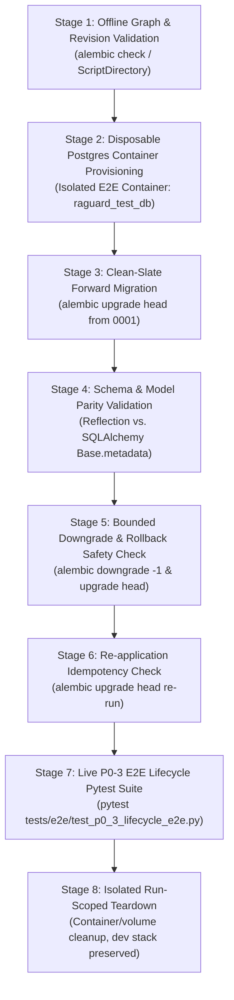

# Veritas-RAG P0-3 — Controlled Migration Remediation Plan

**Document ID:** `P0_3_MIGRATION_REMEDIATION_PLAN`  
**Author:** Senior Database Reliability Engineer & Alembic Migration Specialist  
**Date:** 2026-10-18  
**Scope:** Actionable Remediation Plan for Revisions `20260724_0224febbe7cc` and `20260815_6c11701a28c5`  
**Status:** **REMEDIATION PLAN COMPLETE — READY FOR REVIEW**

---

## 1. Executive Summary

During preflight validation for the Veritas-RAG P0-3 E2E test suite, fresh database schema initialization aborted at revision `20260724_0224febbe7cc` with:
```text
sqlalchemy.exc.ProgrammingError: (sqlalchemy.dialects.postgresql.asyncpg.ProgrammingError) column "is_deleted" of relation "health_scan_jobs" does not exist
[SQL: ALTER TABLE health_scan_jobs DROP COLUMN is_deleted]
```

Subsequent forensic audits documented in [P0_3_ALEMBIC_ROOT_CAUSE_INVESTIGATION.md](file:///d:/RAGuard/P0_3_ALEMBIC_ROOT_CAUSE_INVESTIGATION.md) and [P0_3_MIGRATION_DEPLOYMENT_HISTORY_REVIEW.md](file:///d:/RAGuard/P0_3_MIGRATION_DEPLOYMENT_HISTORY_REVIEW.md) confirmed two critical structural defects resulting from uncurated `alembic revision --autogenerate` executions in the project baseline:

1. **Defect 1 (Revision `0224febbe7cc`):** Unconditionally executes `op.drop_column('health_scan_jobs', 'is_deleted')`. The table `health_scan_jobs` was created in `0008_knowledge_health_schema.py` without `is_deleted`. The column was never introduced by any model or migration, causing an immediate, deterministic failure on every fresh database.
2. **Defect 2 & Latent Failure Cascade (Revision `6c11701a28c5`):** Unconditionally attempts `op.create_table` for **15 tables**. Only two tables (`notification_delivery_logs` and `workspace_webhooks`) are genuinely new Epic 11 entities. The other **13 tables** were already created by upstream migrations (`0003`, `0004`, `0005`, `0007`, `0008`, `c722fc06aec0`, `20260805095756`). If Defect 1 is patched in isolation, the fresh migration runner crashes immediately at line 24 of `6c11701a28c5` on `relation "circuit_breaker_events" already exists`.
3. **Catastrophic Downgrade Hazard in `6c11701a28c5`:** The `downgrade()` function of `6c11701a28c5` unconditionally calls `op.drop_table` on all 15 tables—including core foundational tables `document_chunks`, `chunk_embeddings`, `embedding_jobs`, and `vector_index_metadata`. Executing a downgrade from `6c11701a28c5` on any deployed database would **irrevocably purge core application data**.

This document outlines a strictly controlled, non-destructive, and defensible remediation plan to eliminate these blockers while maintaining schema integrity and backward compatibility.

---

## 2. Verified Facts vs. Assumptions and Unknowns

| Category | Verified Evidence (Empirical) | Assumptions & Unknowns |
|---|---|---|
| **Git Lineage** | - `0224febbe7cc` is merged into `main` and `origin/main`, and is tagged in `v1.0.0`, `v1.0.1`, and `v2.0-epic9-batch2-final`.<br>- `6c11701a28c5` is merged into `main` and `origin/main` (commit `7952d68d069`), but is untagged. | None. Git history is completely verified locally. |
| **Alembic Graph** | - Traversed via `alembic.script.ScriptDirectory`. Single root: `0001`; single head: `wh_01_webhook_crypto`.<br>- `0224febbe7cc` is at index 22; `6c11701a28c5` is at index 50.<br>- `0224febbe7cc` is an unavoidable linear ancestor of `6c11701a28c5` and `HEAD`. | None. DAG ordering is mathematically verified. |
| **CI/CD Execution** | - `.github/workflows/deploy-staging.yml` contains a placeholder deployment hook; does not execute migrations.<br>- `.github/workflows/ci.yml` runs integration tests using `BaseModel.metadata.create_all`, bypassing Alembic.<br>- `scripts/migrate.sh` runs `alembic upgrade head`, but is not automated in CI/CD. | None. Workflows inspected in full. |
| **Live Database State** | - Fresh E2E test database fails deterministically at revision 22 (`0224febbe7cc`). | **UNKNOWN:** Whether any external shared, staging, or production PostgreSQL database has applied `0224febbe7cc` or `6c11701a28c5`, was stamped (`alembic stamp`), or was manually created. |

### Governance Principle Under Deployment Uncertainty
Because external deployment history is **UNKNOWN**, we must strictly assume that an external database *might* already have applied or stamped these revision IDs. Therefore:
- **Rule 1:** Revision IDs (`revision` and `down_revision`) **MUST NOT BE CHANGED**.
- **Rule 2:** The remediation must be **idempotent and non-destructive**, executing safely whether a database is clean-slate, partially migrated, or already stamped.

---

## 3. Complete Migration-Operation Inventory

### 3.1 Inventory of Revision `20260724_0224febbe7cc` (`add_relative_path_to_document.py`)

- **Revision Metadata:** `revision = '0224febbe7cc'`, `down_revision = '680b30cdb5dd'`.
- **Intended Scope:** Add column `relative_path` to `documents` table to support folder-based hierarchical document ingestion.

#### Operation-by-Operation Breakdown

| # | Function | Target Object | Operation | Intended Scope? | Schema Impact / Precondition |
|:---:|---|---|---|:---:|---|
| 1 | `upgrade()` | 16 Analytics/Eval Tables | `op.drop_table(...)` & `op.drop_index(...)` | **NO (Autogen noise)** | Drops 16 tables not registered in `backend.models.__all__` at generation time. |
| 2 | `upgrade()` | `chunk_embeddings` | `op.create_index('ix_chunk_embeddings_document_version_id', ...)` | Secondary | Performance index on existing table. Safe. |
| 3 | `upgrade()` | `document_chunks` | `op.drop_index(...)` (2 indexes) | Secondary | Drops composite tenant/hash and doc/ver indexes. |
| 4 | `upgrade()` | `documents` | `op.add_column('documents', sa.Column('relative_path', sa.String(1024), nullable=True))` | **YES (Primary Scope)** | Adds nullable path column. Precondition: `documents` exists. Postcondition: column present. |
| 5 | `upgrade()` | `embedding_jobs` | `op.create_index('ix_embedding_jobs_document_version_id', ...)` | Secondary | Performance index on existing table. Safe. |
| 6 | `upgrade()` | `health_scan_jobs` | `op.drop_index('ix_health_scan_jobs_tenant_status', ...)` | Secondary | Drops composite index created in `0008`. |
| 7 | `upgrade()` | `health_scan_jobs` | `op.drop_column('health_scan_jobs', 'is_deleted')` | **NO (FATAL DEFECT)** | **Precondition Fails:** Column `is_deleted` does NOT exist in table. PostgreSQL raises `ProgrammingError`. |
| 8 | `upgrade()` | `query_analytics_records` | `op.drop_index(...)` / `op.create_index(...)` | Secondary | Index rebuild on tenant_id. Safe. |
| 9 | `upgrade()` | `stale_embedding_records`| `op.drop_index(...)` / `op.create_index(...)` | Secondary | Index rebuild on chunk_id. Safe. |
| 10 | `downgrade()`| `health_scan_jobs` | `op.add_column('health_scan_jobs', sa.Column('is_deleted', Boolean, ...))` | **DEFECTIVE** | Downgrade re-adds a column that never existed upstream! |
| 11 | `downgrade()`| `documents` | `op.drop_column('documents', 'relative_path')` | Expected | Reverses primary scope. |
| 12 | `downgrade()`| 16 Analytics/Eval Tables | `op.create_table(...)` | Expected for noise | Re-creates the 16 dropped tables. |

#### Analysis:
Guarding or neutralizing line 67 (`op.drop_column('health_scan_jobs', 'is_deleted')`) and line 81 in `downgrade()` completely resolves Defect 1 without side-effects on the intended `relative_path` feature.

---

### 3.2 Inventory of Revision `20260815_6c11701a28c5` (`epic11_notifications.py`)

- **Revision Metadata:** `revision = '6c11701a28c5'`, `down_revision = 'bb700f84136d'`.
- **Intended Scope:** Implement Epic 11 Notification Engine, Celery Delivery, and Webhooks. Genuine tables required: `notification_delivery_logs` and `workspace_webhooks`.

#### Complete Table Audit Across 15 Tables

Every table creation in `upgrade()` was matched against its canonical origin in the repository:

| # | Table Name in `6c11701a28c5` | Canonical Origin Migration | Canonical Origin Scope | Schema Delta in `6c11701a28c5` vs. Origin | Downgrade Impact in `6c11701a28c5` |
|:---:|---|---|---|---|---|
| **1** | `circuit_breaker_events` | `0007_retrieval_reliability_schema.py` | Reliability circuit breaker | **Identical** (10 columns, identical types) | `op.drop_table` would drop preexisting table! |
| **2** | `health_scan_jobs` | `0008_knowledge_health_schema.py` | Knowledge health scans | **Identical** (12 columns, identical types) | `op.drop_table` would drop preexisting table! |
| **3** | `notification_delivery_logs` | **`6c11701a28c5` (NEW)** | **Epic 11 Delivery Logs** | **Genuinely New Table** | Correctly drops Epic 11 table. |
| **4** | `retrieval_sla_logs` | `0007_retrieval_reliability_schema.py` | SLA monitoring | **Identical** (12 columns, identical types) | `op.drop_table` would drop preexisting table! |
| **5** | `vector_reindex_jobs` | `20260805_095756_add_vector_reindex_job.py` | Vector reindexing | **Identical** (17 columns, identical types) | `op.drop_table` would drop preexisting table! |
| **6** | `workspace_webhooks` | **`6c11701a28c5` (NEW)** | **Epic 11 Webhooks** | **Genuinely New Table** | Correctly drops Epic 11 table. |
| **7** | `domain_cooldowns` | `20260802_c722fc06aec0...` | Domain verification | **Identical** (3 columns, identical types) | `op.drop_table` would drop preexisting table! |
| **8** | `identity_providers` | `20260802_c722fc06aec0...` | SSO Identity providers | **Identical** (18 columns, identical types) | `op.drop_table` would drop preexisting table! |
| **9** | `workspace_domains` | `20260802_c722fc06aec0...` | Workspace domain mapping | **Identical** (14 columns, identical types) | `op.drop_table` would drop preexisting table! |
| **10**| `document_chunks` | `0003_chunking_foundation_schema.py` | Foundational chunks | **Identical** (20 columns, identical types) | **CATASTROPHIC DATA LOSS** |
| **11**| `embedding_jobs` | `0004_embedding_pipeline_schema.py` + `20260804_61995c415127` | Embedding tracking | **Identical** (18 cols, including tracking fields from `61995c415127`) | `op.drop_table` would drop preexisting table! |
| **12**| `vector_index_metadata` | `0005_vector_storage_schema.py` | Vector metadata | **Identical** (11 columns, identical types) | `op.drop_table` would drop preexisting table! |
| **13**| `chunk_embeddings` | `0004_embedding_pipeline_schema.py` | Embedding vectors | **Identical** (12 columns, identical types) | **CATASTROPHIC DATA LOSS** |
| **14**| `chunk_relationships` | `0003_chunking_foundation_schema.py` | Chunk parent/child | **Identical** (9 columns, identical types) | `op.drop_table` would drop preexisting table! |
| **15**| `stale_embedding_records`| `0008_knowledge_health_schema.py` | Embedding staleness | **Identical** (9 columns, identical types) | `op.drop_table` would drop preexisting table! |

#### Critical Findings on `6c11701a28c5`:
1. **Zero Schema Alteration on Existing Tables:** The 13 preexisting tables in `6c11701a28c5` do *not* introduce any new columns, altered types, or constraints. Their definitions in `6c11701a28c5` are verbatim copies of the tables already created upstream.
2. **Autogeneration Root Cause:** The migration was autogenerated in an environment where only auth tables existed. Alembic generated `create_table` for all registered models it could not find in that specific database.
3. **Severe Downgrade Danger:** The author generated `downgrade()` by inverting `upgrade()`. Consequently, lines 327–378 issue `op.drop_table` on `document_chunks`, `chunk_embeddings`, `embedding_jobs`, etc. Executing `alembic downgrade -1` from `6c11701a28c5` destroys foundational knowledge base data.
4. **Risks of Blind `if not inspector.has_table(...)`:**
   - If an engineer simply wraps `create_table` in `if not inspector.has_table(...)` without fixing `downgrade()`, the upgrade passes, but any downgrade invocation still executes `op.drop_table` on preexisting tables.
   - If a table exists but has drifted or missing columns, a blind `has_table` check silently skips table creation, leaving runtime code vulnerable to missing-column exceptions. Fortunately, our AST comparison proves all 13 tables are 100% column-identical to their upstream migrations.

---

## 4. Honest Comparison of Remediation Strategies

| Evaluation Criteria | Strategy A: Pure In-Place Surgical Removal | Strategy B: Blind Idempotent Wrapping (`has_table`) | Strategy C: New Head Migration | Strategy D: Defensible Hybrid Hardening (RECOMMENDED) |
|---|---|---|---|---|
| **Fresh Database Behavior** | **Clean.** Corrects historical code; migrations run sequentially without collisions. | **Succeeds**, but leaves 300+ lines of redundant autogen code in version history. | **FATAL FAILURE.** Alembic crashes at revision 22 and never reaches HEAD. | **Clean & Robust.** Neutralizes invalid operations and ensures zero table collisions. |
| **Existing Database (Already Stamped)** | **Safe.** Revision IDs unchanged; Alembic does not re-execute stamped revisions. | **Safe.** Revision IDs unchanged; skipped by Alembic. | Safe, but redundant. | **Safe.** Revision IDs and graph topology strictly preserved. |
| **Partially Migrated / Legacy Database** | Safe if database followed normal migration lineage. | May silently mask incompatible schema drift. | Ineffective. | **Defensive:** Verifies table/column presence before acting. |
| **Downgrade Safety** | High, provided downgrade is pruned to match upgrade. | **CATASTROPHIC** unless downgrade is explicitly fixed. | Clean downgrade of new migration only. | **High:** Explicitly prunes `downgrade()` to only drop genuine Epic 11 objects. |
| **Data Loss & Drift Risk** | Very Low. | High if downgrade is run. | Low. | **Lowest:** Protects existing tables from accidental drops during rollback. |
| **Testability in Isolation** | 100% testable in fresh disposable test container. | 100% testable. | 100% testable. | **100% testable in isolated E2E test stack without touching dev DB.** |
| **Compatibility with Unknown Deployment** | High. Preserves exact revision IDs. | High for upgrade; risky for downgrade. | Ineffective for fresh DBs. | **Optimal:** Safe whether revision was applied, stamped, or clean. |

---

## 5. Recommended Remediation Plan

### 5.1 Overview
We recommend **Strategy D (Defensible Hybrid Hardening)**. It combines surgical curation of erroneous autogenerated statements with defensive column/table checks, and completely secures `downgrade()` against accidental data loss.

### 5.2 Component 1 — Remediation of `20260724_0224febbe7cc`
**Target File:** `backend/database/migrations/versions/20260724_0224febbe7cc_add_relative_path_to_document.py`

#### Actions:
1. **Line 67 (`upgrade()`):** Replace the fatal `op.drop_column('health_scan_jobs', 'is_deleted')` with an idempotent, non-destructive SQL execution:
   ```python
   # Replace:
   # op.drop_column('health_scan_jobs', 'is_deleted')
   # With:
   op.execute("ALTER TABLE health_scan_jobs DROP COLUMN IF EXISTS is_deleted")
   ```
2. **Line 81 (`downgrade()`):** Remove the invalid `op.add_column('health_scan_jobs', sa.Column('is_deleted', ...))` or guard it:
   ```python
   # Replace:
   # op.add_column('health_scan_jobs', sa.Column('is_deleted', sa.BOOLEAN(), server_default=sa.text('false'), autoincrement=False, nullable=False))
   # With:
   pass  # is_deleted was never part of canonical health_scan_jobs schema
   ```

*Rationale:* If any database did have `is_deleted` locally, it is cleanly dropped. On any fresh database, `IF EXISTS` ensures zero error. Downgrade does not pollute the schema with an unwanted column.

---

### 5.3 Component 2 — Remediation of `20260815_6c11701a28c5`
**Target File:** `backend/database/migrations/versions/20260815_6c11701a28c5_epic11_notifications.py`

#### Actions:
1. **Preserve Genuine Epic 11 Schema Operations:**
   - Retain `op.create_table('notification_delivery_logs', ...)` and its 4 indexes.
   - Retain `op.create_table('workspace_webhooks', ...)` and its index.
2. **Prune or Guard 13 Duplicate Table Creasions:**
   - For the 13 preexisting tables (`circuit_breaker_events`, `health_scan_jobs`, `retrieval_sla_logs`, `vector_reindex_jobs`, `domain_cooldowns`, `identity_providers`, `workspace_domains`, `document_chunks`, `embedding_jobs`, `vector_index_metadata`, `chunk_embeddings`, `chunk_relationships`, `stale_embedding_records`), prune them from `upgrade()` or enclose them in:
   ```python
   bind = op.get_bind()
   insp = sa.inspect(bind)
   if not insp.has_table("<table_name>"):
       op.create_table("<table_name>", ...)
   ```
   *Surgical pruning is cleaner and eliminates 300+ lines of duplicate autogenerated code that never belonged in an Epic 11 migration.*
3. **Eliminate Catastrophic Downgrade Hazard:**
   - In `downgrade()`, **REMOVE all `op.drop_table` and `op.drop_index` calls for the 13 preexisting tables**.
   - Retain drops *only* for the genuine Epic 11 entities:
     - `op.drop_table('workspace_webhooks')`
     - `op.drop_table('notification_delivery_logs')`
     - Associated enum drops: `delivery_status_enum`, `notification_type_enum`.

*Rationale:* Guarantees that running `alembic downgrade` from `6c11701a28c5` will only roll back notifications and webhooks, leaving all document chunks, embeddings, and system audit logs completely intact.

---

## 6. Staged Isolated Validation Plan

A staged validation protocol ensures that migrations are proven functional in isolation before any application lifecycle or E2E tests are executed.



### Stage 1: Offline Graph & Revision Validation
- **Action:** Execute offline script checking `ScriptDirectory.walk_revisions("base", "heads")` and confirming single root `0001` and single head `wh_01_webhook_crypto`.
- **Pass/Fail Criteria:** Zero branch divergence; 68 revisions strictly topologically ordered.

### Stage 2: Disposable Database Provisioning
- **Action:** Start isolated E2E postgres container (`raguard-e2e-postgres-<RunId>`) on isolated port 5433 with empty database `raguard_test_db`.
- **Pass/Fail Criteria:** Container healthy; database completely empty (zero user relations).

### Stage 3: Clean-Slate Forward Migration Execution
- **Action:** Execute `docker exec <worker_container> alembic upgrade head`.
- **Pass/Fail Criteria:** Exit code `0`. All 68 migrations apply without SQL error. `alembic_version` contains `wh_01_webhook_crypto`.

### Stage 4: Schema & Model Parity Validation
- **Action:** Run an inspection script inside the container using `sqlalchemy.inspect` to verify:
  1. `health_scan_jobs` exists with 12 canonical columns and no `is_deleted`.
  2. `documents` contains `relative_path` (VARCHAR 1024).
  3. `notification_delivery_logs` and `workspace_webhooks` exist.
  4. `document_chunks`, `chunk_embeddings`, `embedding_jobs` exist and retain all canonical columns.
- **Pass/Fail Criteria:** All expected tables and columns present; zero orphaned or missing foreign key constraints.

### Stage 5: Bounded Downgrade & Rollback Safety Check
- **Action:**
  1. Downgrade from `wh_01_webhook_crypto` down past `6c11701a28c5` to `bb700f84136d`.
  2. Verify that `document_chunks`, `chunk_embeddings`, and `health_scan_jobs` **STILL EXIST** and were not dropped.
  3. Upgrade back to `head`.
- **Pass/Fail Criteria:** Downgrade only drops webhooks and notifications; foundational knowledge tables remain intact.

### Stage 6: Re-application Idempotency Validation
- **Action:** Rerun `alembic upgrade head` immediately against the already-upgraded database.
- **Pass/Fail Criteria:** Exit code `0`; output confirms zero pending migrations and zero schema mutation.

### Stage 7: Live P0-3 E2E Lifecycle Execution
- **Action:** Execute `tests/e2e/test_p0_3_lifecycle_e2e.py` against the migrated database.
- **Pass/Fail Criteria:** All lifecycle scenarios pass (document ingestion, dense/BM25/hybrid retrieval, tenant isolation, parser failure handling, and quiescent cleanup).

### Stage 8: Isolated Run-Scoped Teardown
- **Action:** Remove isolated E2E containers, networks, and test volumes.
- **Pass/Fail Criteria:** All E2E resources purged; development containers (on ports 5432, 6379, 6333, 8000) remain untouched.

---

## 7. Explicit Implementation Approvals Required

Before any implementation steps begin, the following approvals must be explicitly granted:

1. **Authorization to edit historical migration file:**
   `backend/database/migrations/versions/20260724_0224febbe7cc_add_relative_path_to_document.py`
   (Replace `op.drop_column('health_scan_jobs', 'is_deleted')` with `op.execute("ALTER TABLE health_scan_jobs DROP COLUMN IF EXISTS is_deleted")`).
2. **Authorization to edit historical migration file:**
   `backend/database/migrations/versions/20260815_6c11701a28c5_epic11_notifications.py`
   (Prune 13 duplicate table creations and secure `downgrade()` against catastrophic drops of preexisting tables).
3. **Authorization to execute Stages 1–6 (Isolated Migration Validation):**
   Using a disposable test container before running the full P0-3 live E2E lifecycle suite.

---

## 8. Audit & Boundary Confirmation

It is confirmed that throughout this planning phase:
- **Zero source code, test files, migration scripts, or configurations were modified.**
- **No Docker containers, networks, or volumes were started, stopped, or altered.**
- **No database connections were initiated.**
- **All 20 tracked modified files and existing untracked files remain preserved at the preflight baseline.**

---

REMEDIATION PLAN COMPLETE — READY FOR REVIEW
