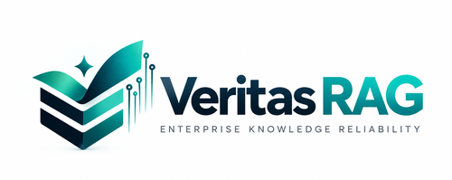
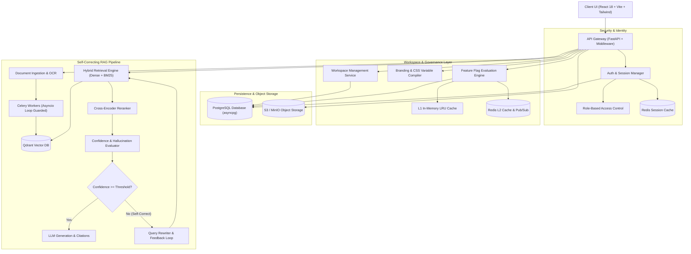

<p align="center">
  
</p>

<h1 align="center">Veritas RAG</h1>

<p align="center">
  <strong>An Enterprise Knowledge Reliability Platform using Self-Correcting Retrieval-Augmented Generation</strong>
</p>

<p align="center">
  <a href="https://github.com/sujith0466/Veritas-RAG/releases"></a>
  <a href="LICENSE"></a>
  <a href="SECURITY.md"></a>
  <a href="docs/VERITAS_RAG_COMPLETE_PROJECT_HANDBOOK.md"></a>
</p>

<hr>

## 📖 Project Overview

**Veritas RAG** (formerly RAGuard AI) is a production-grade, enterprise platform for **Self-Correcting Retrieval-Augmented Generation (RAG)**. Standard LLMs hallucinate, lack real-time enterprise context, retrieve conflicting documents, and operate without deterministic security guardrails. Veritas RAG solves these challenges through:

1. **Self-Correcting Hybrid Retrieval:** Combines Qdrant dense vector embeddings with BM25 sparse keyword retrieval using Reciprocal Rank Fusion (RRF) and Cross-Encoder neural reranking.
2. **Mathematical Hallucination Prevention:** Evaluates evidence relevance, retrieval confidence, and citation consistency before delivering LLM-generated responses.
3. **Strict Multi-Tenant Isolation:** Enforces tenant boundaries from the API gateway down to PostgreSQL schemas, Redis caches, and Qdrant vector payload filters.
4. **Enterprise Concurrency & Session Management:** Features Python 3.13 Celery event-loop stability, instant session restoration, parallelized profile hydration, and non-blocking accessible UI motion.

---

## ✨ Core Capabilities & Architectural Pillars

### 1. Self-Correcting Hybrid Retrieval & Confidence Engine
- **Dense + Sparse Hybrid Search:** Fuses Qdrant dense vector embeddings with BM25 keyword matching via Reciprocal Rank Fusion (RRF).
- **Cross-Encoder Neural Reranking:** Contextually rescores top candidates to maximize precision before prompt assembly.
- **Answer Verification Loop:** Continuously grades retrieved evidence quality, rewrites underperforming queries, enforces policy guardrails, and verifies factual grounding prior to response delivery.

### 2. Multi-Tenant Workspace Lifecycle & Governance
- **Lifecycle Management:** Dedicated workspace states (`ACTIVE`, `ARCHIVED`, `SUSPENDED`, `SOFT_DELETED`) with immutable audit logging.
- **Dynamic Workspace Branding:** Contrast ratio validation ($\ge 4.5:1$ WCAG AA), real-time CSS variable compilation, and Tailwind token integration.
- **Enterprise Feature Flags:** 7-step evaluation engine (Killswitch $\to$ Prerequisites $\to$ Workspace Overrides $\to$ User Targeting $\to$ Role Targeting $\to$ Percentage Rollouts $\to$ Date Windows) with L1 in-memory LRU and L2 Redis Pub/Sub invalidation.

### 3. Enterprise Authentication & Session Reliability
- **Zero Client-Side Trust:** Server-side Argon2id password hashing, cryptographic tokens, and Redis-backed instant token revocation.
- **Optimized Session Restoration:** In-flight promise sharing eliminates duplicate `/api/v1/auth/me` requests, with synchronous local session pre-hydration for zero-latency navbar avatar rendering.
- **Accessible Fast Startup:** Centered, non-blocking `AppBootstrap` status presentation resolving infrastructure health in ~24–50ms with full `prefers-reduced-motion` compliance.

### 4. Background Ingestion & Resilient Queue Topology
- **Managed Event-Loop Workers:** Celery background workers (`processing_job_worker.py`, `watchdog_worker.py`) stabilized with robust asyncio loop lifecycle management under Python 3.13.
- **Multi-Queue Priority Architecture:** Segregated Celery queues (`critical`, `high`, `normal`, `low`, `folders.critical`, `jobs.high`) with distributed locking and worker heartbeats.
- **Document Retention Safeguards:** Folder deletion logic disassociates parent folder hierarchies while preserving document records and compliance retention policies.
- **OCR & Semantic Chunking:** Unified text extraction with Tesseract fallback, context-aware sliding chunk windows, and canonical document manifest generation.

---

## 🏗️ System Architecture



---

## 🛠️ Technology Stack

| Layer | Component | Version | Role in Platform |
| :--- | :--- | :--- | :--- |
| **Frontend** | React 18 + Vite | 5+ | Responsive TypeScript SPA, Tailwind CSS, Framer Motion |
| **State & Navigation** | Zustand + React Context | 4.5+ | Client auth store, theme staging, lazy-loaded routing |
| **Backend API** | FastAPI (Python) | 0.109+ | High-performance asynchronous REST & SSE streaming gateway |
| **Relational Database** | PostgreSQL + asyncpg | 15+ | Transactional persistence, tenant isolation, PgBouncer pooling |
| **ORM & Migrations** | SQLAlchemy 2.0 + Alembic | 2.0+ | Typed async models and schema versioning |
| **Cache & Queue Broker**| Redis | 7+ | Distributed locking, L1/L2 cache, Celery message broker |
| **Background Tasks** | Celery | 5.4+ | Async document ingestion, OCR, chunking, watchdog monitoring |
| **Vector Database** | Qdrant | 1.7.4 | Tenant-partitioned dense vector indexing with HNSW search |
| **Object Storage** | AWS S3 / MinIO | - | Document uploads, presigned URLs, immutable storage |
| **Observability** | Prometheus + OpenTelemetry | - | Distributed tracing, structured JSON logging, metrics scraping |

---

## 📂 Repository Directory Layout

```text
Veritas-RAG/
├── backend/
│   ├── api/v1/              # FastAPI routers, request/response schemas, dependencies
│   ├── core/                # Auth context, security, config, events, logging
│   ├── database/            # Async database engine, sessions, Alembic migrations
│   ├── document/workers/    # Celery workers (processing_job, watchdog)
│   ├── models/entities/     # SQLAlchemy domain entities (Workspaces, Flags, Auth)
│   ├── services/            # Domain logic (Folder, Workspace, FeatureFlag, Auth)
│   ├── tasks/               # Celery task definitions (folders, ingestion, health)
│   └── tests/               # Pytest unit, integration, and worker test suites
├── frontend/
│   ├── src/
│   │   ├── components/      # UI components, layouts, AppBootstrap, UserMenu
│   │   ├── providers/       # Context providers (AuthProvider, FeatureFlag)
│   │   ├── services/        # Typed API clients (authService, workspaceService)
│   │   ├── stores/          # Zustand global stores (authStore)
│   │   └── pages/           # View pages (Dashboard, Auth, Landing)
│   ├── public/              # Branding assets (veritas-rag-logo.png, icons)
│   └── src/tests/           # Vitest suites for auth lifecycle, motion, navigation
├── docs/                    # Architecture specs, handbooks, runbooks, and ADRs
│   ├── Architecture/        # High-level and domain architecture documentation
│   ├── Operations/          # Deployment, configuration, and monitoring runbooks
│   └── VERITAS_RAG_COMPLETE_PROJECT_HANDBOOK.md  # Comprehensive project handbook
├── infrastructure/          # Docker compose, Prometheus rules, Grafana configs
├── docker-compose.yml       # Production/development multi-container composition
├── Makefile                 # Developer build, test, and lifecycle targets
└── pyproject.toml           # Python toolchain and dependency configuration
```

---

## 🚀 Getting Started

### 1. Prerequisites
- **Docker Engine** 24.0+ & **Docker Compose** v2.0+
- **Python** 3.11+ / **Node.js** 18+ (for local native development)

### 2. Environment Configuration
Copy the template configuration to your local environment file:
```bash
cp .env.example .env
```
Inspect `.env` to verify your local database credentials, Redis URL, Qdrant endpoint, and LLM provider keys. For production environments, consult [`.env.prod.example`](.env.prod.example) and the [Configuration Guide](docs/Operations/CONFIGURATION_GUIDE.md).

### 3. Launch Services with Docker Compose
Start the multi-container stack:
```bash
docker compose up -d --build
```
Apply database migrations:
```bash
docker compose exec api alembic upgrade head
```

### 4. Verified Service Endpoints
Once running, the core services are available at:
- **Web Application:** [`http://localhost:5173`](http://localhost:5173)
- **FastAPI Documentation (Swagger UI):** [`http://localhost:8000/docs`](http://localhost:8000/docs)
- **API Health Endpoint:** [`http://localhost:8000/health`](http://localhost:8000/health)
- **Qdrant Vector Console:** [`http://localhost:6333/dashboard`](http://localhost:6333/dashboard)
- **MinIO Object Console:** [`http://localhost:9001`](http://localhost:9001)

---

## 🧪 Testing & Verification

The codebase includes comprehensive unit and integration test suites covering the backend API, Celery workers, frontend session lifecycle, and UI motion:

```bash
# Run backend pytest suite
pytest backend/tests/unit/

# Run specific worker and folder task tests
pytest backend/tests/unit/document/test_processing_job_worker.py
pytest backend/tests/unit/document/test_watchdog_worker.py
pytest backend/tests/unit/tasks/test_folder_tasks.py

# Run frontend Vitest test suite
npm --prefix frontend test

# Run frontend TypeScript typecheck
npm --prefix frontend run typecheck
```

---

## 🔒 Security & Tenant Isolation

- **Zero Client-Side Trust:** Authentication tokens are stored securely and verified server-side.
- **Tenant Context Enforcement:** Every API request verifies workspace context against database ownership records, preventing cross-tenant data access.
- **Vector Partitioning:** Dense vector collections enforce tenant payload filters on all Qdrant similarity queries.
- **Session Revocation:** Redis token blacklists immediately terminate active sessions across browser instances upon logout or credential rotation.
- **No Secret Exposure:** Client builds and frontend stores never receive or cache database credentials, API secret keys, or raw tenant credentials.

---

## 📚 Documentation & Technical References

For detailed guides, please refer to the maintained documentation in the repository:

- 📘 **Complete Project Handbook:** [docs/VERITAS_RAG_COMPLETE_PROJECT_HANDBOOK.md](docs/VERITAS_RAG_COMPLETE_PROJECT_HANDBOOK.md)
- 🏗️ **System Architecture:** [docs/Architecture/high-level-architecture.md](docs/Architecture/high-level-architecture.md) & [docs/Architecture/ARCHITECTURE.md](docs/Architecture/ARCHITECTURE.md)
- 🚀 **Deployment Guide:** [docs/Operations/deployment-guide.md](docs/Operations/deployment-guide.md)
- ⚙️ **Configuration Guide:** [docs/Operations/CONFIGURATION_GUIDE.md](docs/Operations/CONFIGURATION_GUIDE.md)
- 📡 **API Reference:** [docs/API/API_REFERENCE.md](docs/API/API_REFERENCE.md)
- 🧭 **Documentation Index:** [docs/DOCUMENTATION_INDEX.md](docs/DOCUMENTATION_INDEX.md)

---

## 📄 License & Governance

- **License:** Distributed under the [MIT License](LICENSE).
- **Security Policy:** See [SECURITY.md](SECURITY.md) for vulnerability reporting.
- **Contributing:** Review [CONTRIBUTING.md](CONTRIBUTING.md) and [CODE_OF_CONDUCT.md](CODE_OF_CONDUCT.md) before submitting pull requests.
- **Support:** Community channels and issue tracking are detailed in [SUPPORT.md](SUPPORT.md).
- **Release History:** Track updates and changes in [CHANGELOG.md](CHANGELOG.md).
